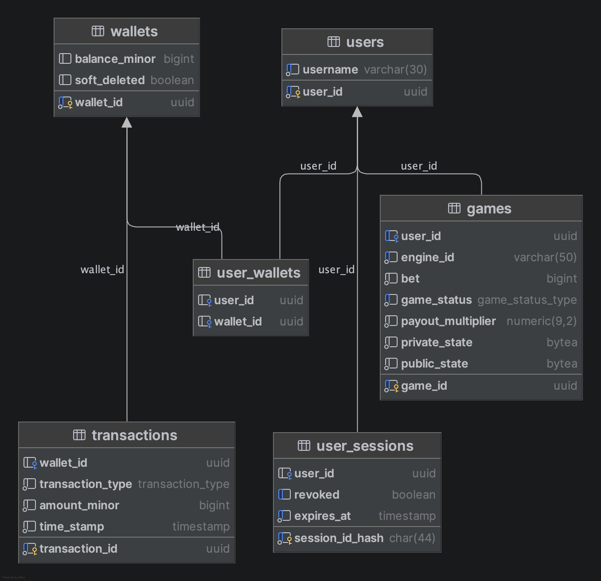

# Casino-Go

## Project overview

This project is an online casino/Remote Game Server (RGS) built in Golang. Engines connect to the casino service via NATS.

### Disclaimer

This is just a portfolio/hobby project and does not represent a production worthy RGS. It serves as a place to demonstrate the knowledge and skills I have obtained building backend services using Golang.

### Projects
- `./casino` - Casino project that handles the core functionality. 
- `./engines/mines` - A simple example of a mines engine.
- `./pkg` - Shared code for all projects to use.
- `./stress-test` - CLI application that stress tests the casino concurrently with a single engine.

### Features
- REST API to authenticate and play games.
- Swagger docs and swagger endpoint.
- Postgres data store for players and games.
- Microservice based engines that communicate with the casino via NATS queue groups. Queue groups allow horizontal scaling of engines, picking one randomly to process the messages.
- Integration tests utilising testcontainers, isolated using go build tags.
- Casino stress test CLI. It can be started within the stress-test directory using `make run-mines games={n_games}`.
- Profiling of services via build tags. All services use the `profile` tag to start up the default profiling server. The Makefile located in the project's root directory contains useful pprof commands to view profiling data. To profile the casino as an example, run `make run-profile` within the casino directory then `make pprof-cpu` from the project's root directory.

### Future improvements 
- Multiplayer games using web sockets (poker, blackjack).
- Implement real authentication handling. Currently the authentication endpoint just creates a new player with a balance to play the engines.

## Running the casino locally

From within the casino directory:
1. Run `make platform` to compose core containers (NATS, Postgres etc).
2. Run `make migrate-up` to initialise the DB. 
3. Run `make run`.
4. Within the `./engines/mines` directory, run `make run` to start the mines engine.

## Database

- Create a migration with `make migration name="{migration_name}"`
- Use `make migrate-up` to run migrations
- Use `make migrate-down` to remove migrations
- Use `make psql` to connect to the service database from the terminal

### Schema (generated by DataGrip)



## VSCode setup

Add this config to .vscode/launch.json:
```json
{
  {
    "name": "Run Casino",
    "type": "go",
    "request": "launch",
    "mode": "auto",
    "cwd": "${workspaceRoot}/casino",
    "program": "${workspaceRoot}/casino/cmd/casino/main.go",
    "buildFlags": [ //These build flags are optional. They enable the profiling endpoints to be registered.
      "-tags",
      "profile"
    ],
    "envFile": "/Users/jordanbrownwork/personal/casino-go/casino/.env"
  }
}
```

Add these settings to your JSON. This configures gopls correctly for the build tags this project uses:
```json
{
  "gopls": {
    "build.buildFlags": [
      "-tags=profile,integration"
    ]
  },
  "go.testTags": "integration",
}
```

## Swagger 

This project uses swag-go to generate swagger docs. Models that contain a field of "string" type but have a format of "json" are actually JSON objects. This is a limitation of the swag-go library it seems. A Postman collection of API routes can be found in [API.postman_collection.json](./API.postman_collection.json).
